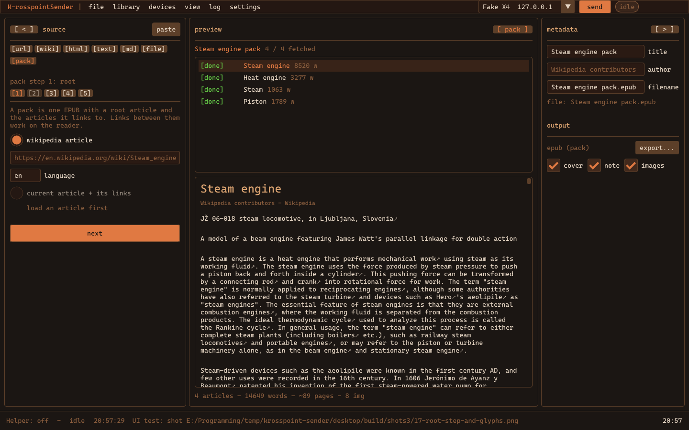
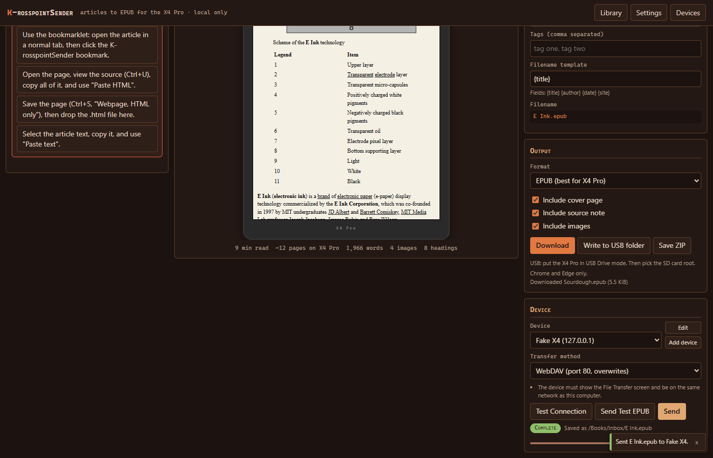
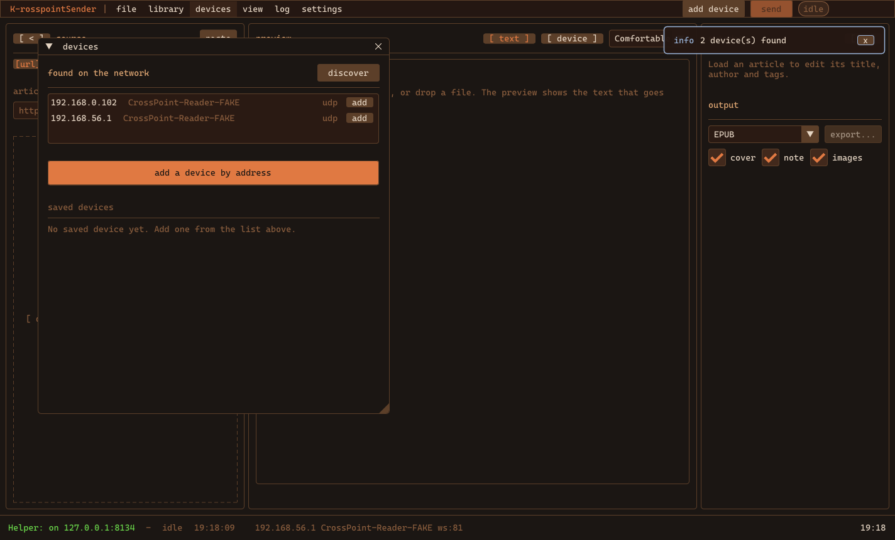
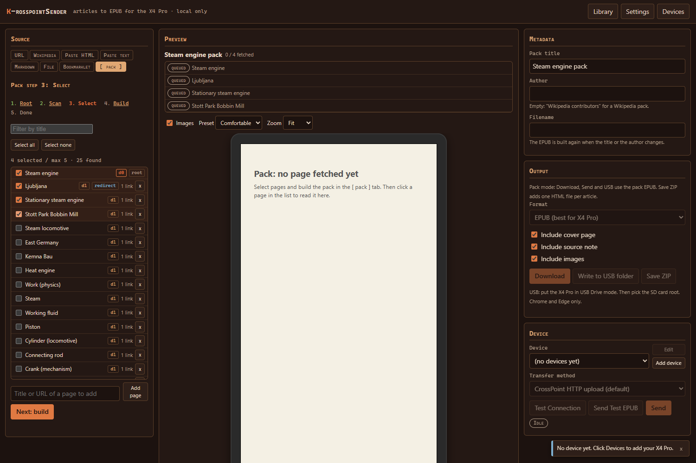

# k-rosspointSender

Turn the web into clean little e-ink books and send them straight to a
CrossPoint reader.

k-rosspointSender takes a web article, a Wikipedia page, pasted HTML or
text, a Markdown or TXT file, or a whole "spider pack" of linked Wikipedia
articles. It cleans the content, builds an EPUB tuned for the Xteink X4 Pro
(480 x 800 e-ink) running [CrossPoint](https://github.com/crosspoint-reader/crosspoint-reader),
and sends it to the reader over Wi-Fi. It also works with any EPUB reader.

It comes in two forms that share one design:

| | Web app | Desktop app |
|---|---|---|
| Runs | in the browser, static site, no backend | native Windows app (C++, Dear ImGui) |
| Fetch any URL | only when the site allows cross-origin reads | yes |
| Wikipedia | yes, through the MediaWiki API | yes |
| Send over Wi-Fi | from a copy opened from disk, from `http://localhost`, or through the desktop helper | yes |
| Send over Bluetooth | Chrome and Edge (Web Bluetooth), needs the CrossPoint ble-transfer firmware build | yes, Windows BLE, finds the reader by scan |
| Find the reader on the LAN | yes, from the offline copy or localhost: helper, crosspoint.local, subnet sweep (the https page can use only the helper) | yes, UDP + HTTP probe |
| USB folder write | Chrome and Edge | yes |
| Spider packs | yes | yes |
| Library, device profiles, settings | IndexedDB | files in your user folder |



## Privacy

Everything runs on your machine. There is no account, no backend, no
telemetry, no analytics, no cloud storage. The only network calls are the
ones you start: fetching the article and its images, and the transfer to
your reader. You can confirm this in the browser's network tab.

## What it does

- **Inputs.** Website URL, Wikipedia URL or title, pasted HTML, pasted text,
  Markdown, TXT, local HTML files, drag-and-drop, clipboard paste, and a
  bookmarklet for pages the browser cannot fetch.
- **Cleanup.** Readability-style extraction. Ads, navigation, cookie
  banners, comments, related-article blocks, scripts and trackers are
  removed. Title, author, date, source URL, headings, paragraphs, images,
  captions, code blocks and simple tables are kept. All HTML is sanitized
  with an allowlist.
- **Wikipedia mode.** Infoboxes, navboxes, edit links, hatnotes and
  reference sections are stripped by default, with options to keep the
  infobox and the references.
- **EPUB output.** Title page, table of contents, cleaned body, images
  converted to grayscale baseline JPEG at 480 px, a source note, and
  metadata. Four style presets: Compact, Comfortable, Large Text,
  Reference. Also HTML, TXT, Markdown and ZIP.
- **Preview.** The cleaned article in a 480 x 800 device frame, with
  reading time and page estimates.
- **Spider packs.** Start from one Wikipedia article, scan the pages it
  links to, pick the ones you want, and build one EPUB. Links between
  bundled pages work inside the book. Links to other pages stay online and
  are marked with an arrow. Every pack has a title page, an included-
  articles list, an external-links page, a missing-articles page, and an
  attribution page with every source URL and the CC BY-SA note.
- **Bundles.** Select several articles in the library and build one EPUB
  with one chapter each, so the reader is not flooded with small files.
- **Transfer.** CrossPoint HTTP upload (default), WebDAV, CrossPoint
  WebSocket upload with progress, USB folder write, manual download, an
  OPDS catalog package, and Bluetooth (Web Bluetooth, CrossPoint BLE file
  transfer protocol; needs the ble-transfer firmware build, see
  `docs/BLE_PROTOCOL.md`).
- **Send a file.** Put any file from disk on the SD card over the same
  transports, for example `firmware.bin` to `/`, then install it on the
  reader from Settings > System > SD Card Firmware Update.
- **Device profiles** with a setup wizard: add device, test connection,
  choose the destination folder on the card, send a test EPUB.
- **Library** of converted articles and packs with transfer history,
  re-export, and delete.



## Sending to CrossPoint

On the reader: Home > File Transfer > Join a Network. The screen shows the
IP address and a QR code. The reader serves its API only while that screen
is open.

| Method | Port | Notes |
|---|---|---|
| CrossPoint HTTP | 80 | `POST /upload`. The app creates the folder, replaces an existing file, and verifies with `/api/files`. |
| WebDAV | 80 | `PUT` overwrites. |
| CrossPoint WebSocket | 81 | Streams the file with progress messages. |
| USB folder | - | Put the reader in USB Drive mode and pick the card. |
| Bluetooth | - | File Transfer > Receive via Bluetooth, then Connect. Chrome or Edge. About 10 to 50 KB/s. Needs the ble-transfer firmware build. |

The default destination is `/Books/K-rosspoint/`.

The desktop app finds the reader on its own: it sends the CrossPoint UDP
"hello" as a broadcast and as a unicast to every address on the subnet,
then probes port 80, then tries `crosspoint.local`. Manual IP entry always
works.

**Browser limit, and the way around it.** A page served over HTTPS cannot
talk to an `http://` device on the LAN. Browsers block that as mixed
content. The web app is one self-contained file, so the fix is simple:
press "Save an offline copy" (or download the file from the releases) and
open it from your disk. A page opened from disk is not HTTPS, so the LAN
upload works. Verified in Chrome, Edge and Firefox. The library then lives
in that browser. Other options: the desktop app, which also acts as a local
helper on `127.0.0.1:8134`, `http://localhost`, the USB folder, or a plain
download.

## Desktop app



- Drop a link, a file or text on the window. Paste a copied page with
  Ctrl+V; on Windows the real HTML and the source URL come from the
  clipboard.
- Resizable and collapsible columns. Device selector and send button in
  the top bar. One devices window for discovery, add, edit and test.
- Themes: Korra Dark and Paper Light, plus user theme files. Crisp system
  monospace font, UI scale presets, custom font, rebindable shortcuts,
  settings search. Idle CPU is near zero.
- Command line:

```
krosspoint_sender --convert <url-or-file> --out article.epub
krosspoint_sender --pack "Steam engine" --out pack.epub [--depth 1] [--max 20] [--lang en]
krosspoint_sender --send article.epub --host 192.168.1.50 [--folder /Books/K-rosspoint/] [--method http|webdav|ws|folder]
krosspoint_sender --discover
```

See [desktop/README.md](desktop/README.md) for the build steps.

## Web app



```
npm install
npm run dev        # http://localhost:5173
npm run build      # dist/index.html, one self-contained file
npm test           # vitest
```

The build is a single HTML file. It runs from a static host, from
`http://localhost`, or opened directly from disk. Deployment notes,
browser limits, the bookmarklet, and the local helper are in
[docs/WEB_APP.md](docs/WEB_APP.md).

## Building the desktop app

Windows with MSYS2 mingw64:

```
pacman -S mingw-w64-x86_64-{toolchain,cmake,ninja,SDL2,curl,libxml2,zlib}
export PATH="/c/msys64/mingw64/bin:$PATH"
cmake -S desktop -B desktop/build -G Ninja
cmake --build desktop/build
ctest --test-dir desktop/build
bash desktop/scripts/package.sh desktop/build   # desktop/dist/ with the runtime DLLs
```

Linux: `libsdl2-dev libcurl4-openssl-dev libxml2-dev zlib1g-dev`, then the
same CMake commands. The code is portable; only Windows has been tested.

## Repository layout

```
src/            web app: extractors, converters, epub, spider, transports, storage, deviceProfiles, settings, ui
tests/          vitest suites and fixtures
bookmarklet/    capture script and builder
helper/         optional Python helper (the desktop app replaces it)
desktop/        native app: core, extract, output, spider, net, app; tests; vendored third_party
docs/           ARCHITECTURE.md (web spec), WEB_APP.md (web user guide), screenshots
tools/          fake CrossPoint device and browser smoke scripts
```

## Testing

Both apps have unit tests, and both were verified end to end:

- generated EPUBs pass [epubcheck](https://github.com/w3c/epubcheck) with
  zero errors, including live Wikipedia packs;
- transfers were driven against a fake CrossPoint server in
  `tools/fake-crosspoint.py`, which mimics the HTTP, WebDAV and UDP
  discovery endpoints;
- a Wikipedia article and a spider pack were sent to a real Xteink X4 Pro
  running CrossPoint and opened on the device.

## Status

1.1. Both apps are at feature parity. Both send over Bluetooth with the
CrossPoint BLE file transfer protocol (docs/BLE_PROTOCOL.md) and both can
send any file to the card, including a firmware image for the reader's
SD Card Firmware Update. Bluetooth needs a CrossPoint build with "Receive
via Bluetooth", proposed upstream from the `feat/ble-file-transfer`
branch; a real EPUB transfer to an Xteink X4 Pro has been verified.

## Credits

- [CrossPoint Reader](https://github.com/crosspoint-reader/crosspoint-reader)
  for the open firmware and its documented transfer API.
- Mozilla Readability, DOMPurify, JSZip, Turndown, Marked, idb, Dear ImGui,
  SDL2, libcurl, libxml2, miniz, md4c, nlohmann/json, cpp-httplib, stb.
- Wikipedia content is available under CC BY-SA 4.0. Packs carry an
  attribution page.

## License

MIT. See [LICENSE](LICENSE).
